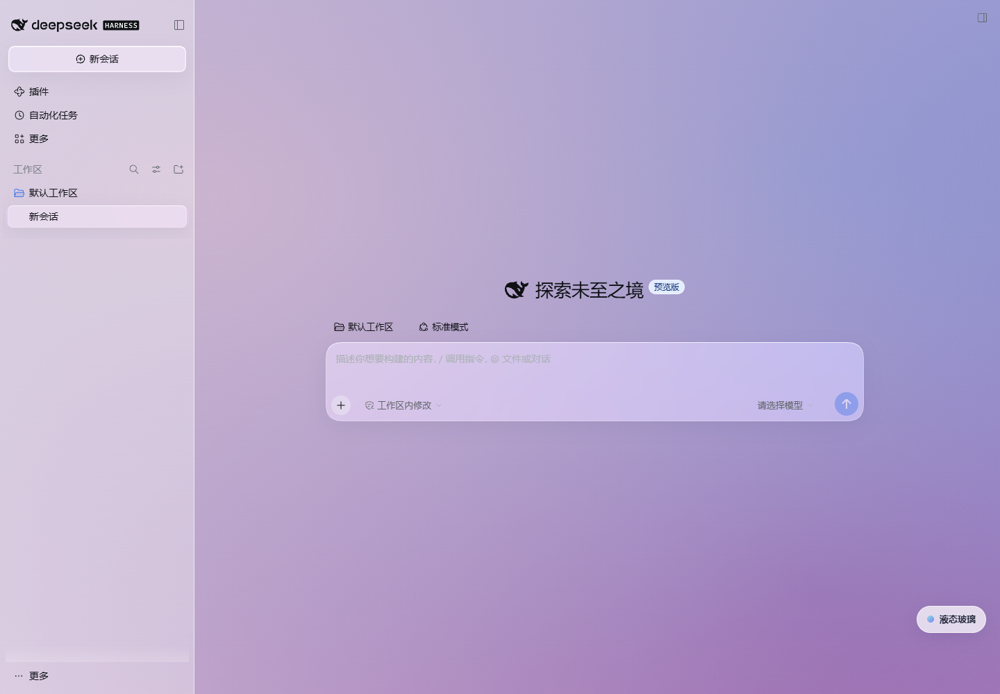
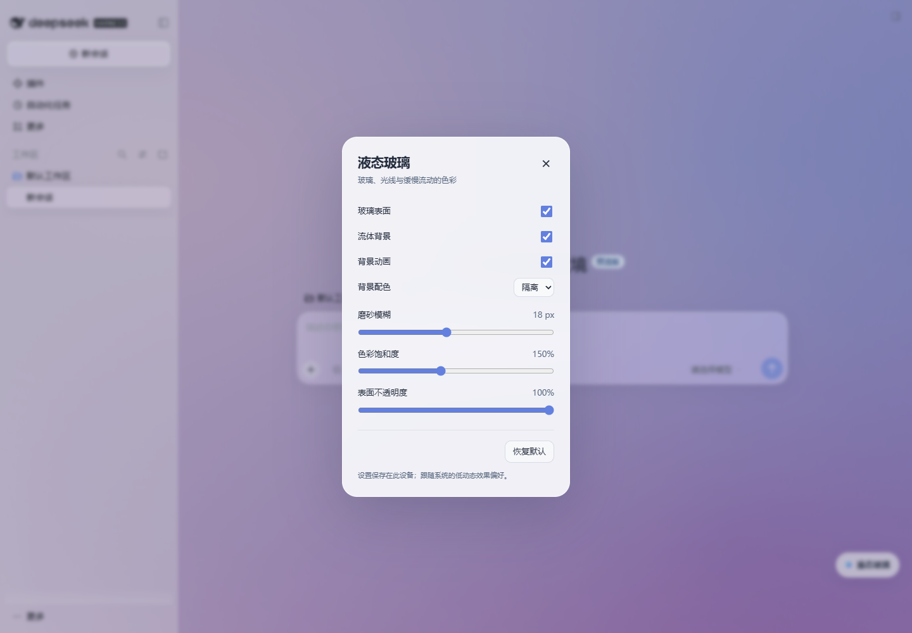

# Liquid Glass · Fluid Background

A maintained compatibility fork of [Ink-bai5844/dsh-liquid-glass-fluid-background](https://github.com/Ink-bai5844/dsh-liquid-glass-fluid-background), with the original MIT license preserved. Maintained by **gtggdd4mzb-source**. [中文说明](README.zh.md)

Version **0.3.0** targets **DeepSeek Harness 0.2.2-rc.5** (Desktop and Web). It adds translucent surfaces and a CSS gradient background, with separate switches for each. It does not implement optical refraction or a WebGL fluid simulation.




These screenshots show the actual DSH 0.2.2-rc.5 Web frontend started from the installed Desktop bundle in a clean isolated profile. The additional `preview-light.png` / `preview-dark.png` images show the included test fixture, not the host application.

## Install

Use the CLI bundled with your current Harness, rather than a separately installed older CLI. With that CLI on your PATH:

```sh
dsh plugin --profile desktop add https://github.com/gtggdd4mzb-source/dsh-liquid-glass-fluid-background/releases/download/v0.3.0/dsh-liquid-glass-fluid-background-0.3.0.tgz
```

Replace `desktop` with `web` for the web profile. Fully restart Harness after the first installation. Open the **Liquid Glass** capsule near the lower-right corner.

The package name and `ui-theme-liquid-glass` row intentionally match the original plugin, so this fork replaces that skin in the same profile. Do not enable two copies together. If another theme owns the same tokens, turn that theme off before assessing this one.

## Controls

- Glass surfaces and gradient background can be enabled independently.
- Six palettes: Isolation, Aurora, Sunset, Violet, Ocean and Silver.
- Blur 0–40 px, saturation 100–220%, and surface opacity 10–100%.
- Separate animation switch; system reduced-motion preferences take priority.
- Light/dark appearance follows the Harness body theme attribute.
- The settings dialog supports keyboard navigation, Escape, focus restoration, narrow windows, reduced transparency and forced colors.

Settings stay on the current browser/device under `localStorage["dsh.liquid-glass.v1"]`. Existing numeric/boolean settings migrate in place. Blocked or corrupt storage falls back safely. The displayed surface opacity is a multiplier of each base material's opacity, not the opacity of the whole application.

## Integration and cleanup

The host contributes a single inline script through the public `webserver/index-inject` event; it neither rewrites installed Harness files nor serves an extra script endpoint. A dependency-free `dsh.client` entry owns browser lifecycle cleanup, including disable/re-enable. The early script and the client entry share one singleton, so duplicate delivery does not duplicate the UI.

On scope disposal, the skin removes its styles, settings UI, surface attributes, event handlers, observer and timers. Saved preferences are retained. In deployments that only consume boot rows, disabling/removing the plugin takes effect on the next page reload or app restart. Internal UI errors remove the overlay and leave the host theme in place.

Surface discovery is bounded to 1,600 nodes and 100 marked surfaces per scan. Text-only streaming updates do not trigger a scan. Future changes to host markup may leave some surfaces unstyled; compatibility is only declared for the tested 0.2.2 version family. The declared engine range explicitly includes the 0.2.2 prerelease tuple.

## Privacy

The skin makes no network requests, requests no account/API credentials, and does not read conversations, files or host settings. It only reads its own preferences, the document language, the host theme attribute, and surface geometry/computed colors.

## Develop and verify

Requires Node 24.9+:

```sh
npm ci
npm run check
npx playwright install chromium
npm run test:browser
npm pack
```

`src/client.js` is the single browser implementation. `npm run build` writes a classic inline payload and a lifecycle entry wrapped in DSH's `window.__ModuleLoader__.load` format; no transpiler or runtime dependencies are needed. Generated `lib/` files are committed so GitHub-source installation works without build scripts. Browser tests use a clearly labeled fixture, not an authenticated user session. `PLAYWRIGHT_CHANNEL=msedge` optionally selects installed Edge.

Release validation also exercised the Cordis 4.1.0 event scope and the actual `renderIndexInjections` implementation extracted from DSH Desktop 0.2.2-rc.5. See [compatibility evidence](COMPATIBILITY.md) for the limits of that validation.

## Remove

Remove or disable this package in Harness's Plugins page, then reload/restart if necessary. To erase saved preferences too, remove `dsh.liquid-glass.v1` from the origin's local storage. No host installation files need restoring.

## License and provenance

MIT; see [LICENSE](LICENSE). Original project: **Ink-bai5844**. This fork rebuilds delivery, lifecycle, controls, validation and packaging for DSH 0.2.2. It is an independent community plugin, not an official DeepSeek release.
