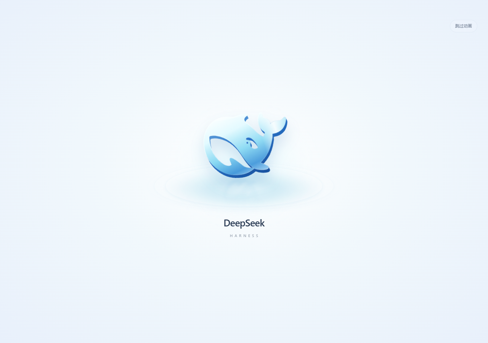
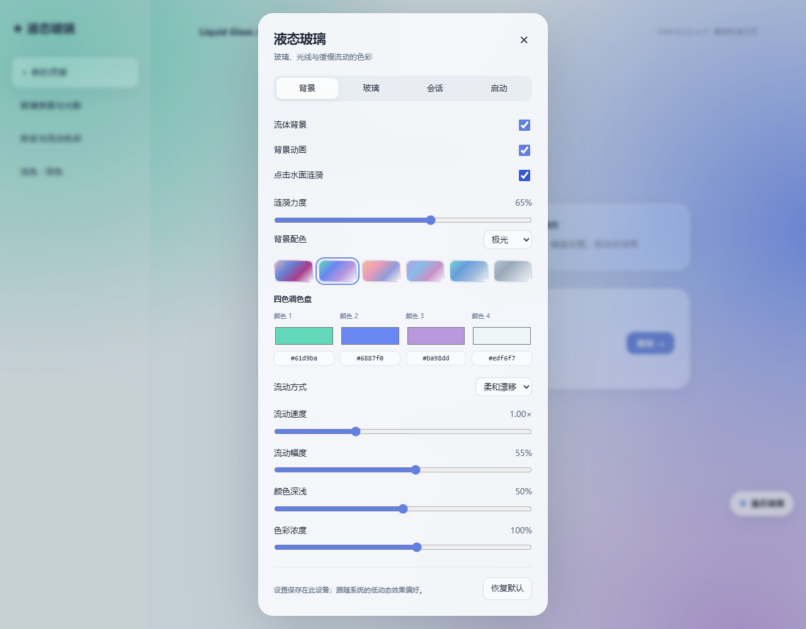
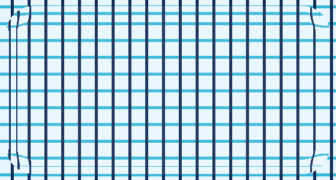

# Liquid Glass · Fluid Background

A maintained compatibility fork of [Ink-bai5844/dsh-liquid-glass-fluid-background](https://github.com/Ink-bai5844/dsh-liquid-glass-fluid-background), with the original MIT license preserved. Maintained by **gtggdd4mzb-source**. [中文说明](README.zh.md)

Version **0.6.1** targets **DeepSeek Harness 0.2.2-rc.5** (Desktop and Web). It adds a damped 2D finite-difference water surface activated by blank-background clicks, adjustable ripple strength, and an iOS-inspired skin for DSH's session header, transcript and composer. Blank transcript space is interactive, while message editors and controls keep their normal behavior. The existing palette studio, moving color field, rounded-edge SVG refraction and whale startup animation remain available. Water waves are numerically simulated and shaded from their surface normals; the effect is a bounded browser approximation, not physical light transport or Apple's private renderer.


These screenshots show the actual DSH 0.2.2-rc.5 Web frontend started from the installed Desktop bundle in a clean isolated profile. The additional `preview-light.png` / `preview-dark.png` images show the included test fixture, not the host application.

The session-style screenshots and interactive preview use DSH 0.2.2-rc.5's actual semantic DOM markers with synthetic test messages; they are explicitly not captures of the Harness application.

## Install

In the native Desktop app, install the release tarball from the Plugins page (the desktop profile is managed by Electron). In a Web profile, use the current Harness CLI:

```sh
dsh plugin --profile web add https://github.com/gtggdd4mzb-source/dsh-liquid-glass-fluid-background/releases/download/v0.6.1/dsh-liquid-glass-fluid-background-0.6.1.tgz
```

Fully restart Harness after the first installation. Open the **Liquid Glass** capsule near the lower-right corner.

The package name and `ui-theme-liquid-glass` row intentionally match the original plugin, so this fork replaces that skin in the same profile. Do not enable two copies together. If another theme owns the same tokens, turn that theme off before assessing this one.

## Controls

- Glass surfaces and gradient background can be enabled independently.
- Six palettes: Isolation, Aurora, Sunset, Violet, Ocean and Silver.
- Background / Glass / Startup tabs, with arrow-key navigation.
- Four color pickers plus HEX inputs; editing a preset creates a persistent custom palette. The fourth color also anchors the background ground color.
- Soft drift, Waves, Orbit and Aurora flows. Speed 0.10–3.00×, amplitude 0–100%, color depth 0–100%, color richness 0–180%. Motion off or zero amplitude pauses the layers; dark mode maps the chosen colors into darker tones.
- Edge refraction 0–50 px, highlight intensity and pointer-following highlights. Rounded-edge displacement bends backdrop pixels while foreground text stays unfiltered. Try 3–8 px blur for clearer glass.
- Blur 0–40 px, saturation 100–220%, and surface opacity 10–100%.
- Background clicks inject impulses into a bounded damped 2D wave grid. Waves propagate, overlap, and dissipate; strength is adjustable. Input controls, links, buttons and the transcript are excluded from ripple input.
- The Conversation tab enables a separate iOS-inspired host skin for the session header, view tabs, user turns, transcript spacing and glass composer. Host editing, attachments and message actions stay in place. The plugin launcher moves clear of the composer when they overlap.
- Separate animation switch; system reduced-motion preferences take priority.
- An optional startup animation: a layered ice-blue whale rises above a luminous waterline with reflection, ripples and a highlight sweep. It runs for about 2.8 seconds once per page boot, including a full app launch or page reload, then reveals the application. Plugin reloads do not replay it. The animation begins when the plugin can draw, not before Electron creates its window.
- Turn **Whale startup animation** off for future launches, or use **Replay startup** to preview it. Click the overlay/Skip or press a key to dismiss it. Reduced motion and forced colors skip autoplay; an explicit replay shows a brief static reveal. The visual overlay never gates host readiness, and a hard timeout removes it even if CSS animation fails.
- Light/dark appearance follows the Harness body theme attribute.
- The settings dialog supports keyboard navigation, Escape, focus restoration, narrow windows, reduced transparency and forced colors.

Settings stay on the current browser/device under `localStorage["dsh.liquid-glass.v1"]`. Existing numeric/boolean settings migrate in place. Blocked or corrupt storage falls back safely. The displayed surface opacity is a multiplier of each base material's opacity, not the opacity of the whole application.

Startup visual, captured in the standalone test preview:



## Integration and cleanup

The host contributes a single inline script through the public `webserver/index-inject` event; it neither rewrites installed Harness files nor serves an extra script endpoint. A dependency-free `dsh.client` entry owns browser lifecycle cleanup, including disable/re-enable. The early script and the client entry share one singleton, so duplicate delivery does not duplicate the UI.

On scope disposal, the skin removes its styles, settings UI, surface attributes, event handlers, observer and timers. Saved preferences are retained. In deployments that only consume boot rows, disabling/removing the plugin takes effect on the next page reload or app restart. Internal UI errors remove the overlay and leave the host theme in place.

Surface discovery is bounded to 1,600 nodes and 100 marked surfaces per scan. Text-only streaming updates do not trigger a scan. Future changes to host markup may leave some surfaces unstyled; compatibility is only declared for the tested 0.2.2 version family. The declared engine range explicitly includes the 0.2.2 prerelease tuple.

Optical displacement is limited to eight visible surfaces, each no larger than 500,000 square pixels. Other surfaces keep standard blur. Maps rebuild on element resize rather than every frame; moving background layers animate transforms. Refraction zero, reduced transparency and forced colors remove optical filters and overlays. Cleanup restores the original inline positioning/styles. SVG backdrop-filter support and nested host backdrop roots can affect rendering; unsupported browsers may retain the blur fallback. This release was checked in installed Edge and native Windows DSH, not every browser or GPU.




These are test-fixture captures. The grid's edges visibly bend with both blur and highlight opacity set to zero, and restore exactly when the optical renderer is disposed.

## Privacy

The skin makes no network requests, requests no account/API credentials, and does not read conversations, files or host settings. It only reads its own preferences, the document language, the host theme attribute, and surface geometry/computed colors.

## Develop and verify

Requires Node 24.9+:

```sh
npm ci
npm run check
npx playwright install chromium
npm run test:browser
npm run test:startup
npm run test:studio
npm pack
```

`src/client.js` owns the skin and bounded wave solver; `src/startup.js` owns the optional startup visual. The build embeds the bundled whale vector into both delivery formats, without runtime asset requests. `npm run build` writes a classic inline payload and a lifecycle entry wrapped in DSH's `window.__ModuleLoader__.load` format; no transpiler or runtime dependencies are needed. Generated `lib/` files are committed so GitHub-source installation works without build scripts. Browser checks use host-shaped semantic markup, not an authenticated conversation. `PLAYWRIGHT_CHANNEL=msedge` optionally selects installed Edge.

Release validation also exercised the Cordis 4.1.0 event scope and the actual `renderIndexInjections` implementation extracted from DSH Desktop 0.2.2-rc.5. See [compatibility evidence](COMPATIBILITY.md) for the limits of that validation.

## Remove

Remove or disable this package in Harness's Plugins page, then reload/restart if necessary. To erase saved preferences too, remove `dsh.liquid-glass.v1` from the origin's local storage. No host installation files need restoring.

## License and provenance

MIT; see [LICENSE](LICENSE). Original project: **Ink-bai5844**. Whale contour: DeepSeek Harness's bundled favicon, with source attribution in [THIRD_PARTY_NOTICES.md](THIRD_PARTY_NOTICES.md). Layered vector shading and CSS perspective create a 2.5D visual, rather than a volumetric model. This fork is an independent community plugin, not an official DeepSeek release.
