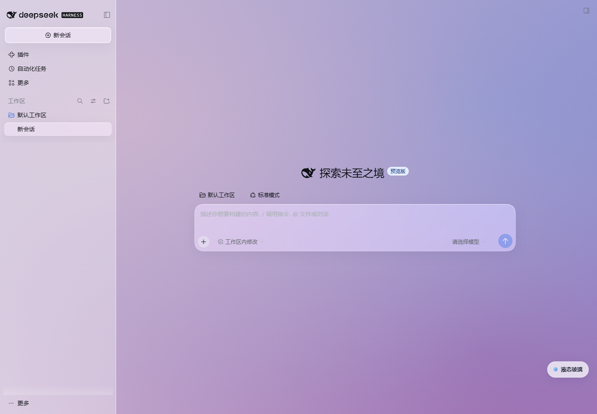
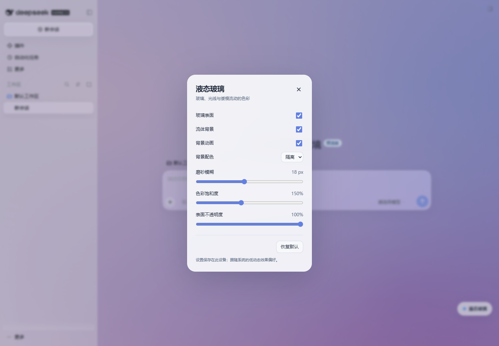
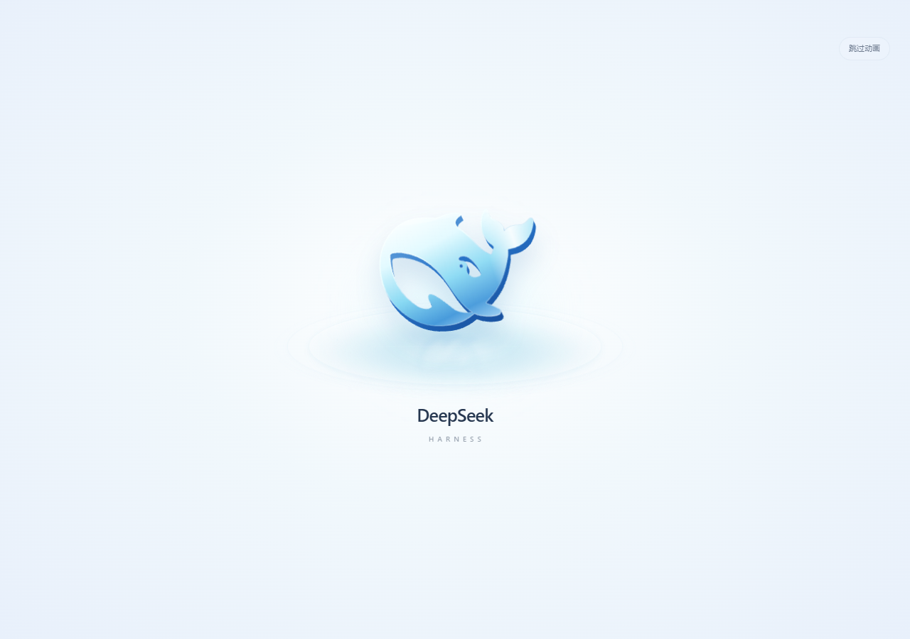

# 液态玻璃 · 流体背景

这是 [Ink-bai5844 原插件](https://github.com/Ink-bai5844/dsh-liquid-glass-fluid-background) 的维护分支，保留原作者署名与 MIT 许可，由 **gtggdd4mzb-source** 维护。[English](README.md)

**0.4.0** 面向 **DSH 0.2.2-rc.5 桌面端和 Web 端**：提供半透明玻璃表面、CSS 渐变流体背景，以及鲸鱼浮出水面的启动动画。渐变背景不是 WebGL 流体模拟，也不包含光学折射。




以上为桌面安装包附带的 DSH 0.2.2-rc.5 Web 前端在干净隔离 profile 中的真实截图。另附的 `preview-light.png` / `preview-dark.png` 来自测试演示页，不是宿主运行截图。

## 安装

桌面端请在“插件”页选择版本发布页的安装包；desktop profile 由 Electron 管理。Web 端可用当前 DSH 命令行安装：

```sh
dsh plugin --profile web add https://github.com/gtggdd4mzb-source/dsh-liquid-glass-fluid-background/releases/download/v0.4.0/dsh-liquid-glass-fluid-background-0.4.0.tgz
```

首次安装后完全退出并重启 DSH，在右下方打开“液态玻璃”。

包名与插件行 ID 沿用原插件，因此同一 profile 内会替换旧版本。不要同时启用两份；如另一个主题也修改同名颜色令牌，请先停用另一个主题再查看效果。

## 功能

- 玻璃表面、流体背景、背景动画分别开关。
- 隔离、极光、日落、紫雾、海洋、银灰六种配色。
- 模糊 0–40 px、饱和度 100–220%、表面不透明度 10–100%。
- 跟随 DSH 浅深色；支持键盘、Escape 关闭后焦点返回、窄屏设置面板。
- 遵循系统低动态、减少透明度和强制对比色偏好。
- 鲸鱼启动动画：冰蓝玻璃鲸鱼从水下模糊浮现，抬升并转正，带出倒影、水纹和掠过表面的高光；约 2.8 秒后淡入主界面。每次页面启动播放一次，刷新页面也会播放，插件热重载不会重复播放。它在插件开始绘制时出现，不替换 Electron 创建窗口前的系统启动画面。
- 设置里提供“鲸鱼启动动画”开关和“重播启动动画”。点击画面/跳过，或按键即可提前结束。系统减少动态效果或强制对比色时不自动播放，手动重播仅显示短暂静态画面。装饰动画不阻止宿主启动，定时器会兜底移除。

设置只保存在当前设备、当前站点的 `dsh.liquid-glass.v1` 中，并兼容旧版数值与开关。存储不可用时本次会话仍可使用。表面不透明度是各材质原始不透明度的倍率，不改变文字或整个应用的不透明度。

启动动画独立预览（截取浮出水面的中段）：



## 兼容与卸载

通过 DSH 公开的 `webserver/index-inject` 行协议送达桌面和网页，并用不依赖已删除模块的 `dsh.client` 入口处理停用、重新启用和清理。不修改 DSH 安装文件，也不额外开放服务端口。

停用时会清理自己的样式、面板、标记、监听器、观察器与定时器。仅消费启动注入行的部署需刷新页面或重启应用才会移除效果。保存过的个人偏好会保留；需要清空时删除上述本地存储键。

每次扫描最多检查 1,600 个节点、标记 100 个表面，文字流式更新不会触发全页扫描。后续宿主布局变化可能使部分区域不再呈现玻璃效果。兼容范围限定为已验证的 0.2.2 版本族，未声称验证所有后续 DSH 版本。

插件不会访问网络、会话、文件或凭据，只读取自己的偏好、语言、宿主主题标记与表面样式。当前电脑的其他主题插件组合未作为全覆盖兼容测试；应逐个启用以排查颜色冲突。

## 开发

Node 24.9+，执行 `npm ci`、`npm run check`、`npx playwright install chromium`、`npm run test:browser`、`npm run test:startup`、`npm pack`。

`src/client.js` 管理皮肤，`src/startup.js` 管理启动动画，构建时把鲸鱼矢量内嵌到启动载荷与生命周期模块。动画用分层矢量和 CSS 透视实现 2.5D 厚度、光影与水面效果，运行时无额外依赖或素材网络请求。仓库提交 `lib/`，直接从 GitHub 安装也有完整产物。验证范围见 [COMPATIBILITY.md](COMPATIBILITY.md)。

## 来源

原作者 **Ink-bai5844**；鲸鱼轮廓沿用 DSH 自带 favicon，来源和许可见 [THIRD_PARTY_NOTICES.md](THIRD_PARTY_NOTICES.md)。MIT 许可见 [LICENSE](LICENSE)。这是独立社区插件。
